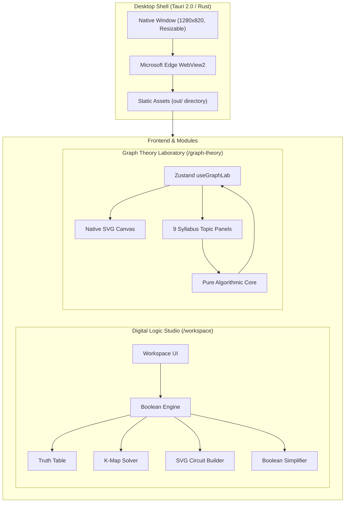

# Architecture & System Design

## 🏛 High-Level System Architecture
BoolStudio is architected with a decoupled dual-target design:
1. **Frontend Core**: A pure client-side Next.js 16 / React 19 application compiled to static assets via `output: 'export'`.
2. **Desktop Shell**: A native Rust container powered by Tauri 2.0 utilizing Microsoft Edge WebView2 on Windows.

## 📦 Key Modules & Component Boundaries
* `src-tauri/`: Tauri 2.0 Rust project defining application metadata, window geometry, security capabilities, and NSIS installer packaging.
* `src/components/Workspace/WorkspaceView.tsx`: Studio Viewport with compact top toolbar, operators ribbon, horizontal navigation tabs, and a fixed 560px scroll-contained visualization canvas utilizing Next.js `dynamic()` imports for on-demand chunk loading.
* `src/features/venn-sets/components/VennSetsLab.tsx`: Studio Viewport for Venn & Sets with compact toolbar (2/3 sets switch, label toggles), mode tabs, and matched 2-column 560px grid (left: SVG Venn diagram, right: scroll-contained controls/truth-table).
* `src/lib/parser/`: Tokenizes string expressions and parses them into AST nodes using recursive descent syntax checks.
* `src/lib/logic/`: Evaluates AST nodes against boolean input bindings and constructs hierarchical logic circuits.
* `src/lib/truth-table/`: Computes truth table matrices for $2^N$ variable assignments.
* `src/lib/kmap/`: Builds Gray-code aligned Karnaugh Maps (for up to 4 variables) and solves minterm prime implicant covers.
* `src/lib/simplifier/`: Transforms ASTs step-by-step while recording applied Boolean laws.
* `src/features/venn-sets/`: Self-contained Venn & Sets Lab feature (Unit 1 basic set algebra and Unit 3 Principle of Inclusion-Exclusion). Contains SVG region geometry, set-to-Boolean parser adapter, dedicated Zustand store (`useVennLabStore`), identity verifier, and PIE calculator.
* `src/hooks/useBooleanStudio.ts`: Zustand store managing interactive signal states and digital logic analysis results.
* `src/hooks/useGraphLab.ts`: Centralized Zustand store managing single graph state `{ vertices, edges, isDirected }`, undo stack, presets, and active highlights.
* `src/lib/graph-theory/`: Pure algorithm functions (zero UI/DOM dependencies) returning `AlgorithmOutput<T>` (`{ result, explanation, highlight, steps }`):
  * `graph-model.ts`: Vertex/edge creation, deletion, label reuse (A-Z, A1-Z1), and directed/undirected conversion.
  * `matrix-builders.ts`: Adjacency/Incidence matrices, Handshaking lemma, matrix power $(A)^k$ walk counter.
  * `connectivity.ts`: Degrees, connected/strongly connected components, BFS shortest path, cycle detection.
  * `walks-cycles.ts`: Interactive Walk vs Trail vs Path vs Circuit vs Cycle classification.
  * `euler.ts`: Undirected & directed Hierholzer's traversal algorithm with step frames.
  * `hamiltonian.ts`: Backtracking cycle/path solver with Dirac/Ore checks.
  * `tree.ts`: Tree triad check ({Connected, Acyclic, $|E| = |V| - 1$}), cycle witness, BFS spanning tree generator.
  * `bipartite.ts`: BFS 2-colouring bipartite detector and Kőnig odd cycle witness extractor.
  * `matching.ts`: Augmenting path bipartite matching and constructive Hall's condition failure witness subset $S$.
  * `planar-bound.ts`: General/bipartite edge bounds, Euler polyhedral formula, non-planarity proofs for $K_5$ and $K_{3,3}$.
  * `coloring.ts`: Welsh-Powell greedy coloring, exact chromatic number $\chi(G)$ ($n \le 10$), clique/degree bounds, manual coloring conflict detector.
* `src/components/GraphLab/`:
  * `GraphLabView.tsx`: 2-column desktop split layout (Left ~60% Canvas + Toolbar, Right ~40% Active Panel) stacking on mobile.
  * `GraphCanvas.tsx`: Native SVG canvas with pointer events, smooth dragging, ghost line to cursor in `add-edge` mode, arrowheads for directed mode, and active highlight synchronization.
  * `Toolbar.tsx`: Top toolbar with Select/Move, Add Vertex, Add Edge, Delete, Directed/Undirected toggle, Presets, Undo, Clear, and $V = X \mid E = Y$ count badge.
  * 9 dedicated topic panels: `RepresentationsPanel.tsx`, `DegreeWalksPanel.tsx`, `EulerPanel.tsx`, `HamiltonianPanel.tsx`, `TreePanel.tsx`, `BipartitePanel.tsx`, `MatchingPanel.tsx`, `PlanarPanel.tsx`, `ColoringPanel.tsx`.

## 🔄 Graph Theory Data Flow
1. User interacts with the canvas or toolbar (e.g., adding/moving vertices, connecting edges, toggling directed mode, loading a preset).
2. The central Zustand store (`useGraphLab`) updates `graph: Graph` and pushes previous state to `history: Graph[]` for undo capability.
3. The active topic panel calls its respective pure algorithm in `src/lib/graph-theory/` to compute results, plain-English explanations, and highlights.
4. The panel updates `activeHighlight` in the store (or per-step highlight during step player playback).
5. `<GraphCanvas />` reactively renders the updated graph, applying node/edge color overlays and stroke highlights corresponding to the active analysis without duplicating algorithmic logic.
