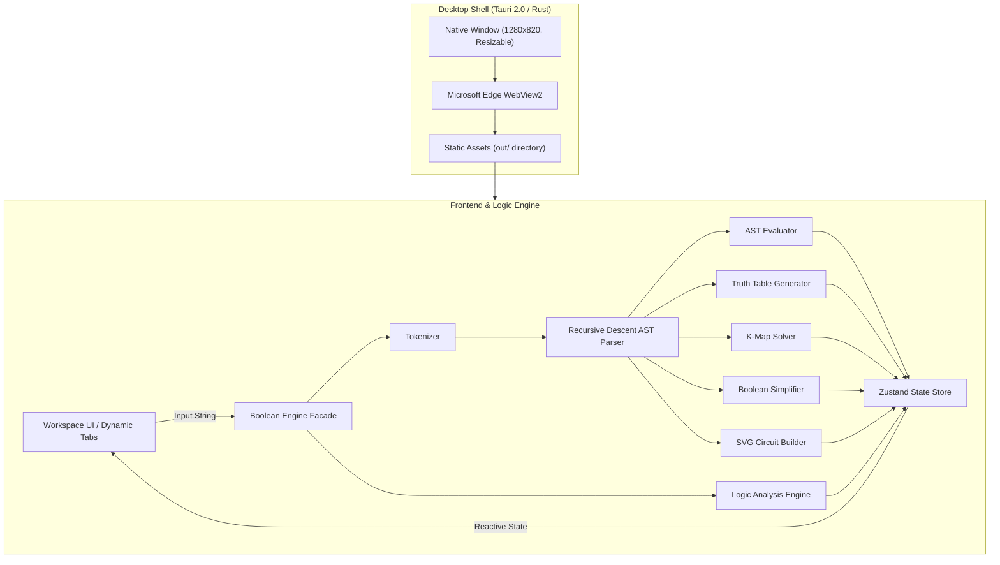

# Architecture & System Design

## 🏛 High-Level System Architecture
BoolStudio is architected with a decoupled dual-target design:
1. **Frontend Core**: A pure client-side Next.js 16 / React 19 application compiled to static assets via `output: 'export'`.
2. **Desktop Shell**: A native Rust container powered by Tauri 2.0 utilizing Microsoft Edge WebView2 on Windows.

## 📦 Key Modules & Component Boundaries
* `src-tauri/`: Tauri 2.0 Rust project defining application metadata, window geometry, security capabilities, and NSIS installer packaging.
* `src/components/Workspace/WorkspaceView.tsx`: Tab-based workspace view utilizing Next.js `dynamic()` imports for on-demand chunk loading.
* `src/lib/parser/`: Tokenizes string expressions and parses them into AST nodes using recursive descent syntax checks.
* `src/lib/logic/`: Evaluates AST nodes against boolean input bindings and constructs hierarchical logic circuits.
* `src/lib/truth-table/`: Computes truth table matrices for $2^N$ variable assignments.
* `src/lib/kmap/`: Builds Gray-code aligned Karnaugh Maps (for up to 4 variables) and solves minterm prime implicant covers.
* `src/lib/simplifier/`: Transforms ASTs step-by-step while recording applied Boolean laws.
* `src/hooks/useBooleanStudio.ts`: Zustand store managing interactive signal states and analysis results.

## 🔄 Data Flow
1. User enters or modifies a Boolean expression in `<ExpressionInput />`.
2. `analyzeBooleanExpression` parses the expression and generates visualization datasets.
3. The user switches between result tabs (`Truth Table`, `Logic Circuit`, `Karnaugh Map`, `Simplification`, `Logic Analysis`). Dynamic imports ensure only the active tab's chunk is rendered.
4. Clicking input badges in the circuit or control bar updates `activeInputValues` in Zustand, recalculating active wire signal glow and truth table row highlights instantaneously.
5. In desktop mode, all asset requests are loaded directly from local application resources without any local web server or open TCP ports.
